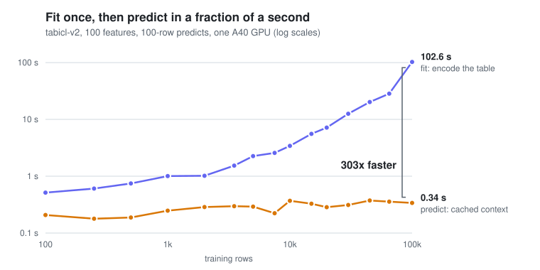

<p align="center">
  <picture>
    <source media="(prefers-color-scheme: dark)" srcset="https://raw.githubusercontent.com/VectorInstitute/tabctx/main/docs/assets/logo-dark.svg">
    
  </picture>
</p>

<p align="center">
  <b>The serving engine for tabular foundation models.</b><br>
  Fit a table once, keep it on the GPU, and answer every later prediction in a fraction of a second.
</p>

<p align="center">
  <a href="https://pypi.org/project/tabctx/"></a>
  <a href="https://github.com/VectorInstitute/tabctx/actions/workflows/unit_tests.yml"></a>
  <a href="https://codecov.io/github/VectorInstitute/tabctx"></a>
  <a href="https://vectorinstitute.github.io/tabctx/"></a>
  
  <a href="https://github.com/VectorInstitute/tabctx/blob/main/LICENSE.md"></a>
</p>

<p align="center">
  <a href="https://vectorinstitute.github.io/tabctx/"><b>Docs</b></a> ·
  <a href="#quickstart">Quickstart</a> ·
  <a href="#coding-agents">Coding agents</a> ·
  <a href="https://tabctx-agent-demo-g6svlkvhga-uc.a.run.app">Live demo</a> ·
  <a href="https://github.com/VectorInstitute/tabctx/blob/main/docs/serving.md">Serving guide</a> ·
  <a href="https://github.com/VectorInstitute/tabctx/blob/main/docs/how-it-works.md">How it works</a> ·
  <a href="https://github.com/VectorInstitute/tabctx/blob/main/docs/benchmarks.md">Benchmarks</a>
</p>

---

[TabPFN](https://github.com/PriorLabs/TabPFN) and
[TabICL](https://github.com/soda-inria/tabicl) often beat gradient
boosting with no training loop ([our numbers](https://github.com/VectorInstitute/tabctx/blob/main/docs/benchmarks.md#accuracy-on-real-datasets)):
the training table *is* the prompt. Encoding that table is the expensive part, and it's the same
work on every prediction. **tabctx encodes each table once, keeps the
result in a GPU cache shared by many tables and users, and serves
predictions against it**, behind one HTTP endpoint you run on your
own GPUs.

<p align="center">
  <picture>
    <source media="(prefers-color-scheme: dark)" srcset="https://raw.githubusercontent.com/VectorInstitute/tabctx/main/docs/assets/fit-vs-predict-dark.svg">
    
  </picture>
</p>

## Highlights

- **Fit once, predict many.** A fitted table becomes a *context*, addressed
  by id. Every later predict against it skips the re-encode.
- **Many tables, one GPU.** Contexts share a byte-budgeted cache. The
  coldest one is evicted (or spilled to disk and restored on next use),
  and a fit that would run the GPU out of memory is refused *before* it runs.
- **Two models, one endpoint.** `tabicl-v2` and `tabpfn-3.5` behind
  `GET /v1/models`; pick one per request. Adding a model is one class.
- **Prediction intervals.** Regression predicts a distribution, so you can
  ask for its quantiles (say a 90% interval) at no extra cost:
  `reg.predict_quantiles(X, [0.05, 0.95])`.
- **Drop-in scikit-learn.** `TabctxClassifier` and `TabctxRegressor` take
  DataFrames with text, dates and missing values as they are, and work with
  pipelines and `cross_val_score`.
- **Tools for coding agents.** `tabctx-mcp` lets Claude Code, Codex and
  Gemini CLI fit, predict, explain and run what-ifs on a CSV.
- **Built to run in production.** Multi-GPU placement, multi-replica routing
  on Ray Serve (or a single process without Ray), tenant isolation, and a
  container image. Validated on L4, A40 and A100 GPUs.

## Quickstart

Run a server on your laptop (CPU works; it uses the GPU if there is one):

```bash
pip install "tabctx[standalone,tabicl,client]"
TABCTX_BACKEND=tabicl python -m tabctx.serve        # http://127.0.0.1:8000
```

Then use it like any scikit-learn model:

```python
from sklearn.datasets import fetch_openml
from sklearn.model_selection import train_test_split
from tabctx import TabctxClassifier, TabctxClient

X, y = fetch_openml("credit-g", version=1, as_frame=True, return_X_y=True)
X_train, X_test, y_train, y_test = train_test_split(X, y, random_state=0)

clf = TabctxClassifier(client=TabctxClient("http://127.0.0.1:8000"))  # the server's default model
clf.fit(X_train, y_train)          # encodes the table once, on the server
clf.score(X_test, y_test)          # 0.77, no training loop, no tuning
clf.predict_proba(X_test[:5])      # reuses the cached context: ~50 ms on a laptop
```

On a GPU server, use the image (TabICL and TabPFN included, weights
downloaded on first use):

```bash
docker run --gpus all -p 8000:8000 -e TABCTX_BACKEND=tabicl ghcr.io/vectorinstitute/tabctx
```

Prefer plain HTTP? Every client is a thin wrapper over two calls:

```bash
curl localhost:8000/v1/tabctx/fit -F dataset_id=churn -F target=churned -F file=@train.csv
curl localhost:8000/v1/tabctx/predict -F dataset_id=churn -F file=@today.csv
```

The [serving guide](https://github.com/VectorInstitute/tabctx/blob/main/docs/serving.md)
covers Ray Serve, several GPUs, uploads, tenants and every setting.

## Coding agents

Coding agents can read a CSV, but they can't learn from it. `tabctx-mcp`
gives them tabular foundation models as tools: `inspect_table`,
`evaluate` (vs. gradient boosting), `fit_model`, `predict`, `what_if`
and `explain`.

```bash
pip install "tabctx[mcp]"
export TABCTX_BASE_URL=http://127.0.0.1:8000   # your tabctx server
claude mcp add tabctx -- tabctx-mcp             # or codex, gemini, pi
```

Then ask: *"Which of today's patients are most likely to be readmitted,
and what would lower their risk?"* In the
[demo](https://tabctx-agent-demo-g6svlkvhga-uc.a.run.app), Claude Code,
Codex and pi each answer it on 30,000 real hospital stays and are scored
against what actually happened.
[More on agents →](https://github.com/VectorInstitute/tabctx/blob/main/docs/coding-agents.md)

## Why tabctx

| | Model in your process | Hosted API | **tabctx** |
|---|:---:|:---:|:---:|
| Data stays on your machines | ✅ | ❌ | ✅ |
| Many tables cached at once, per tenant | ❌ | ✅ | ✅ |
| Refuses a fit before it runs out of GPU memory | ❌ | n/a | ✅ |
| Models from several labs behind one endpoint | ❌ | ❌ | ✅ |
| Open source, no per-call metering | ✅ | ❌ | ✅ |
| Newest API-only models | ❌ | ✅ | ❌ |

A model in your process (`TabPFNClassifier().fit(...)`) caches one table
inside one Python object. A hosted API handles the serving for you, on
its servers. tabctx is the serving layer for when you want both: many
users and tables, on GPUs you control.

## Models

| Model id | Model | Weights license |
|---|---|---|
| `tabicl-v2` | [TabICLv2](https://github.com/soda-inria/tabicl) (Inria) | BSD-3-Clause: commercial use OK |
| `tabpfn-3.5` | [TabPFN-3.5](https://github.com/PriorLabs/TabPFN) (Prior Labs) | Non-commercial; production use needs a [license from Prior Labs](https://priorlabs.ai/pricing) |

TabPFN weights download after you accept Prior Labs' terms (set
`TABPFN_TOKEN`). tabctx itself is Apache 2.0; each model's weights keep
their own license.

## Learn more

The full documentation lives at **[vectorinstitute.github.io/tabctx](https://vectorinstitute.github.io/tabctx/)**: guides, concepts, and the Python, HTTP and configuration reference.

- [Serving guide](https://github.com/VectorInstitute/tabctx/blob/main/docs/serving.md): install options, Ray Serve or standalone, multi-GPU, table files, tenants
- [How it works](https://github.com/VectorInstitute/tabctx/blob/main/docs/how-it-works.md): the architecture, the context cache, memory admission
- [Benchmarks](https://github.com/VectorInstitute/tabctx/blob/main/docs/benchmarks.md): latency, throughput and accuracy on real GPUs and datasets
- [Roadmap](https://github.com/VectorInstitute/tabctx/blob/main/ROADMAP.md) and [changelog](https://github.com/VectorInstitute/tabctx/blob/main/CHANGELOG.md)

## Contributing

Issues and PRs are welcome. The unit tests need no GPU (`uv run pytest
tests/unit`); see [CONTRIBUTING.md](https://github.com/VectorInstitute/tabctx/blob/main/CONTRIBUTING.md).
If tabctx is useful to you, a ⭐ helps others find it.

<p align="center"><sub>Built at the <a href="https://vectorinstitute.ai">Vector Institute</a>. Apache 2.0.</sub></p>
