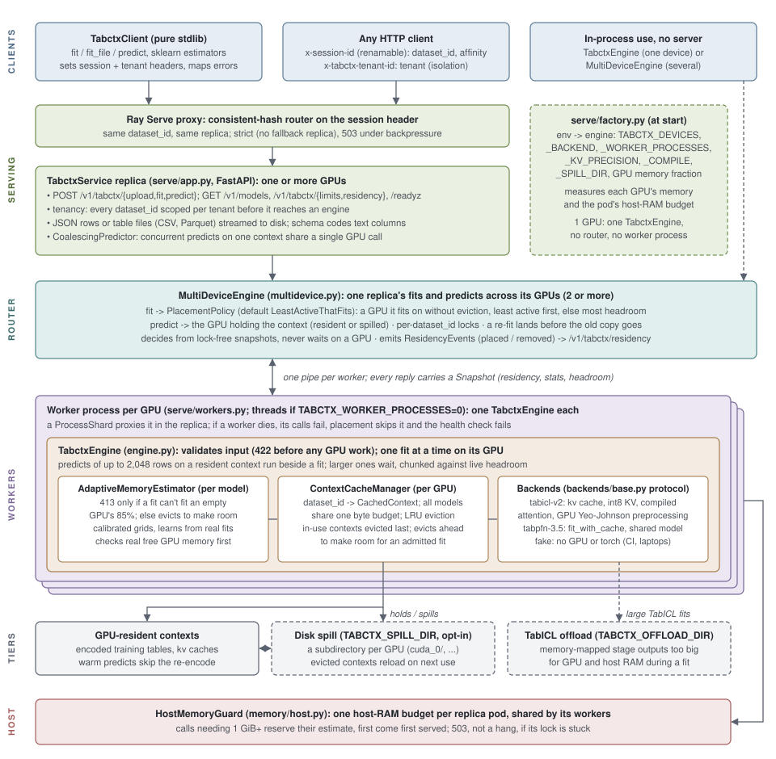

<p align="center">
  <a href="https://github.com/VectorInstitute/tabctx/actions/workflows/unit_tests.yml">
    
  </a>
  <a href="https://github.com/VectorInstitute/tabctx/actions/workflows/integration_tests.yml">
    
  </a>
  <a href="https://codecov.io/github/VectorInstitute/tabctx">
    
  </a>
  <a href="https://pypi.org/project/tabctx/">
    
  </a>
  
  
  <a href="LICENSE.md">
    
  </a>
</p>

# tabctx

Multi-tenant context caching and serving for tabular in-context-learning
(ICL) foundation models: [TabICL](https://github.com/soda-inria/tabicl)
and [TabPFN](https://github.com/PriorLabs/TabPFN) behind **one standard
endpoint**, chat-completions style -- requests pick a model by exact id
(`"model": "tabicl-v2"` or `"tabpfn-3.5"`, discoverable via
`GET /v1/models`), and all models on a GPU share one context cache and
one memory budget. A protocol seam (`backends/base.py`) keeps adding
models cheap.

## Quickstart: as a scikit-learn model

```bash
pip install "tabctx[client]"
export TABCTX_BASE_URL=https://proxy.vectorinstitute.ai   # or your own deployment
export TABCTX_API_KEY=...                                  # a gateway key, if it needs one
```

```python
from sklearn.datasets import fetch_openml
from sklearn.model_selection import train_test_split
from tabctx import TabctxClassifier

X, y = fetch_openml("credit-g", version=1, as_frame=True, return_X_y=True)
X_train, X_test, y_train, y_test = train_test_split(X, y, random_state=0)

clf = TabctxClassifier(model="tabpfn-3.5").fit(X_train, y_train)
clf.score(X_test, y_test)          # the training table stays cached on a GPU
clf.predict_proba(X_test)
```

`TabctxClassifier` and `TabctxRegressor` (`tabctx/estimators.py`) take
DataFrames, arrays or lists of rows with text columns, dates and missing
values as they are, return labels as given, and work with clone,
pipelines and `cross_val_score`. Each table travels as one Parquet file;
large predicts are split under the request limit (`max_request_bytes`),
and a context the server dropped is fit again from the training file
the estimator keeps. The API key never appears in a repr and is left out
of pickles, so with `n_jobs > 1` or a saved model set `TABCTX_API_KEY`.

The lower-level client speaks the HTTP API directly:

```python
client = TabctxClient("http://localhost:8000")
client.models()                                    # -> tabicl-v2, tabpfn-3.5
client.fit(X, y, dataset_id="churn", model="tabpfn-3.5")
client.predict("churn", X_test)                    # served by tabpfn-3.5
client.fit_file("train.parquet", target="churned", dataset_id="churn", model="tabicl-v2")
client.predict_file("churn", "test.csv", model="tabicl-v2")
```

Deploy one model (`TABCTX_BACKEND=tabicl`) or several
(`TABCTX_BACKEND=tabicl,tabpfn` -- first listed is the default model).
The TabPFN id follows the checkpoint `tabpfn` loads, set by its
`TABPFN_MODEL_VERSION` (`v3.5` by default in `tabpfn` 9.x -> `tabpfn-3.5`;
`v3` -> `tabpfn-3`).

## Tabular models as tools for coding agents (`tabctx-mcp`)

Coding agents read files and write code well, but they can't learn
from a table on their own. `tabctx-mcp` gives them TabPFN and TabICL as
tools, so an agent can answer "which customers will leave, and why?"
from a CSV. One MCP server works with Claude Code, Codex and Gemini
CLI. The same tools also run as a JSON command line, and as a pi
extension for agents without MCP.

```bash
pip install "tabctx[mcp]"
export TABCTX_BASE_URL=https://proxy.vectorinstitute.ai TABCTX_API_KEY=vp_...
claude mcp add tabctx -- tabctx-mcp          # Claude Code (passes its environment on)
codex mcp add tabctx -- tabctx-mcp           # Codex; then in ~/.codex/config.toml, under
                                             #   [mcp_servers.tabctx]:
                                             #   env_vars = ["TABCTX_BASE_URL", "TABCTX_API_KEY"]
gemini mcp add tabctx tabctx-mcp \
  -e 'TABCTX_BASE_URL=$TABCTX_BASE_URL' -e 'TABCTX_API_KEY=$TABCTX_API_KEY'   # Gemini CLI
tabctx-mcp pi-extension > ~/.pi/agent/extensions/tabctx.ts                     # pi (no MCP)
```

The single quotes matter. Gemini CLI expands `$VARS` when it starts the
server, so the key isn't written into its settings file. Agents without
MCP or an extension can run the same tools as shell commands that print
JSON: `tabctx-mcp fit history.csv --target Churn`, `tabctx-mcp predict
churn current.csv`, and so on (`tabctx-mcp --help`).

| Tool | What it does |
|------|--------------|
| `inspect_table` | Columns, their kinds, missing values and likely ids. With a target, the task and class balance. |
| `evaluate` | Held-out accuracy of each model next to a gradient-boosting baseline. |
| `fit_model` | Fits on every labelled row in seconds and saves the model under a name. |
| `predict` | Writes the table with prediction and probability columns, and returns the top-ranked rows. |
| `what_if` | Predicts hand-made rows, or one real row with some columns changed. |
| `explain` | Permutation importance: which columns the model relies on. |

Fitted models live in `.tabctx-mcp/` (or `$TABCTX_MCP_HOME`), so a model
fitted in one call is still there for the next. `tabctx-mcp skill`
prints the guide for agents. The churn demo in
[`examples/agent_demo/`](examples/agent_demo/) runs the same task with
each agent and scores their predictions against what the customers
actually did.

## Why does this exist?

Tabular foundation models like TabICL and TabPFN make predictions in an
unusual way: there is no per-dataset training loop. You hand the model a
labeled training table and the rows you want predictions for, and it
produces answers in a single forward pass -- the training table *is* the
prompt ("in-context learning"). That's what makes them exciting: one
pretrained model, any table, no training pipeline.

It also creates a serving problem. Encoding the training table is by far
the most expensive part of that forward pass, and it's identical every
time you predict against the same training set. Both TabICL and TabPFN
know this: each can cache its own encoded training table (both call this
their "KV cache", by analogy to LLMs) so repeat predictions skip the
re-encode. But that cache lives inside one Python estimator object in
one process. The moment you want to *serve* these models -- many users,
many datasets, one GPU -- you need things a single object can't give
you:

- keep many datasets' encoded tables cached at once, each addressable
  by id, isolated per tenant;
- know how much GPU memory each one costs, evict the coldest when the
  budget fills, and refuse a request that would OOM the GPU *before*
  it runs;
- route repeat requests to wherever their cached table lives when the
  service scales past one replica.

**tabctx is that layer.** LLM serving went through the same transition
-- a per-request KV cache inside one process became a managed,
multi-tenant, memory-governed resource (vLLM's PagedAttention is the
famous example). tabctx does the analogous job for tabular ICL models,
where the cached unit is a training table's encoding rather than a chat
session's tokens. As far as we can tell nobody had built this before
(searched PyPI, GitHub, and arXiv).

Two deliberate non-choices, briefly: it isn't built *on* vLLM, because
vLLM's machinery is specialized for autoregressive token-by-token
generation, which these models don't do. And it isn't written in a
"faster language": like vLLM itself, the heavy math runs in the model's
GPU kernels, so plain Python orchestration behind a standard Ray Serve
deployment is exactly fast enough.

## Architecture



*Figure: a request enters through Ray Serve's consistent-hash proxy
(affinity on the session header) into a `TabctxService` replica, which
resolves the tenant, reads inline JSON rows or a table file (CSV or
Parquet, sent with the request or uploaded first), encodes text columns
with the context's schema, and coalesces
same-context predicts. With several GPUs, a `MultiDeviceEngine` places
each fit on one GPU and routes predicts to the GPU holding the context,
from lock-free snapshots; each GPU's engine runs in its own worker
process. A GPU's engine validates input, admits a fit on its estimated
memory need, keeps encoded contexts in a byte-budgeted LRU cache, and
dispatches to whichever backend fit the context. Evicted contexts
optionally spill to local disk and reload on their next use, and one
host-memory guard admits large fits against the pod's RAM across all
its workers. A single-GPU replica calls its one engine directly (editable
source: `docs/figures/architecture.svg`).*

The unit everything revolves around is a **context**: one training
table, encoded once by one model, addressed by `dataset_id` (scoped per
tenant) and reused by every later `predict()` against it. A context
carries its payload (the fitted estimator with its kv cache), the model
that fit it, its shape, its schema (column names, and the codes of its
text columns, so new rows are encoded the same way), plus a measured
byte cost. All models deployed on a device share one
cache and one memory budget, so admission control sees the whole
device's usage regardless of which model a request picks.

## Quick wins

**See it work with zero setup** (no GPU, no model download: a fake
backend stands in for TabICL):

```bash
pip install tabctx
curl -sO https://raw.githubusercontent.com/VectorInstitute/tabctx/main/examples/local_fit_predict.py
python local_fit_predict.py
```

**Use it for real**, with TabICL doing the actual predicting:

```bash
pip install "tabctx[tabicl]"
```

```python
from tabctx import TabctxEngine, ContextCacheManager
from tabctx.backends.tabicl import TabICLBackend
from tabctx.memory import AdaptiveMemoryEstimator, PowerLawMemoryEstimator, A100_40GB_TABICL_CALIBRATION

estimator = AdaptiveMemoryEstimator(fallback=PowerLawMemoryEstimator(A100_40GB_TABICL_CALIBRATION))
cache = ContextCacheManager(capacity_bytes=estimator.ceiling_bytes())
engine = TabctxEngine(backend=TabICLBackend(), cache=cache, estimator=estimator)

# task is inferred from y_train when omitted (non-integer numbers, or many
# distinct whole numbers such as prices, mean regression); pass
# task="classification" or "regression" to be explicit. Missing values
# (NaN, or null in JSON) are fine: both models handle them.
dataset_id = engine.fit(X_train, y_train)
result = engine.predict(dataset_id, X_test, return_proba=True)

# The whole point: reuse the same cached context for a new test batch,
# with no re-fit cost.
result2 = engine.predict(dataset_id, other_X_test)
```

**Serve it over HTTP** with Ray Serve: `src/tabctx/serve/app.py` is a
ready-to-run deployment (`fit`/`predict` endpoints, health checks, live
memory-usage reporting). See `benchmarks/README.md` for how to measure it
once it's running.

**Talk to a deployment** as a scikit-learn model (see the Quickstart
above), or with the bundled client (pure stdlib, sets the
routing/tenancy headers for you, raises the same tabctx exceptions the
in-process engine does):

```python
from tabctx.client import TabctxClient

client = TabctxClient("http://localhost:8000", tenant_id="acme")
client.fit(X_train, y_train, dataset_id="churn-v1")
result = client.predict("churn-v1", X_test, return_proba=True)
client.fit_file("train.parquet", target="churned", dataset_id="churn-v2")
```

## Scaling out: multi-replica serving

The context cache is in-process and per-replica, so at `num_replicas >= 2`
requests for one dataset must consistently reach the replica that holds
its context. The deployment ships with Ray Serve's consistent-hash
request router (requires ray >= 2.58) configured for strict session
affinity, and the contract is simply: **send the dataset_id as the
`x-session-id` header on every `/v1/tabctx/fit` and `/v1/tabctx/predict`
call.**

```bash
curl -X POST $URL/v1/tabctx/fit \
  -H "content-type: application/json" -H "x-session-id: my-dataset" \
  -d '{"train_X": [[1,2],[3,4]], "train_y": [0,1], "dataset_id": "my-dataset"}'

curl -X POST $URL/v1/tabctx/predict \
  -H "content-type: application/json" -H "x-session-id: my-dataset" \
  -d '{"dataset_id": "my-dataset", "test_X": [[5,6]]}'
```

Details worth knowing:

- fit() adopts the header value as the dataset_id if the body omits one; a
  header/body mismatch is rejected 422 (a silent mismatch would mis-route).
- Omitting the header still works, but only routes correctly on
  single-replica deployments.
- Affinity is strict (no fallback replica): if the owning replica is
  backpressured, callers see retry-with-backoff/503 rather than a
  spurious 404 from a replica that doesn't hold the context.
- Responses report `served_by` (the replica tag) so affinity is
  observable and testable end to end.
- When replicas share one physical GPU (e.g. 2 replicas at
  `num_gpus: 0.5`), set `TABCTX_GPU_MEMORY_FRACTION` (e.g. `0.45`) so
  each replica budgets its share of GPU memory. The budget is the
  visible device's real memory (an L4's 24GB, an A100's 40GB), detected
  at startup and reported by `/readyz` as `gpu_capacity_bytes`.
- If the deployment renames the affinity header
  (`RAY_SERVE_SESSION_ID_HEADER_KEY`), construct the client with
  `session_header=` to match; the header name is the routing key.
- `TABCTX_BACKEND=fake` runs the whole serve stack without a GPU or
  torch -- `tests/integration/test_multi_replica_affinity.py` uses it to
  prove the multi-replica contract on a laptop.

## Several GPUs in one replica

A replica that can see several GPUs serves from all of them
(`TABCTX_DEVICES=auto`, the default, or an explicit `cuda:0,cuda:1,...`):
one engine per GPU, with its own backends, cache and spill directory,
behind the same API. No client changes and no routing header needed.

- **Placement.** Each fit goes to a GPU where the table fits *without
  evicting* anyone, preferring the least active GPU (calls in flight,
  then calls in the last 30s). If no GPU can take it without eviction,
  it goes to the GPU with the most headroom. Concurrent users spread
  across GPUs, and a large table gets a whole GPU's headroom.
- **Predicts** run on the GPU that holds the context, including after a
  spill and restore, or a replica restart.
- **Limits.** Neither TabICL nor TabPFN can split one context across
  GPUs, so a table's ceiling is one GPU's memory. What more GPUs buy is
  N x the resident cache and N fits/predicts in flight at once.
- **Concurrency.** Routing reads lock-free snapshots, so it never waits
  on a GPU's work: fits and predicts on different GPUs run at the same
  time. Fits and evicts of the *same* dataset_id are serialized, so a
  retried fit can't leave two copies. A re-fit lands first and only then
  replaces the old copy: a failed re-fit (413, OOM) leaves the previous
  context serving.
- **A process per GPU.** Each GPU's engine runs in its own worker process
  (`TABCTX_WORKER_PROCESSES=1`, the default with several GPUs; `0` runs
  them as threads). Fits are host-bound, so threads would contend for
  Python's GIL: on 4x A100, four concurrent fits ran at ~4x aggregate
  from processes and 2-3x from threads. A worker that dies fails the
  replica's health check, so the serving framework restarts it.
- **Small predicts don't wait for fits.** A predict of up to 2,048 rows
  against a resident context runs beside a fit on the same GPU (~0.1 s
  instead of the fit's full duration); larger predicts and restores of
  spilled contexts wait their turn.
- **Placement is pluggable.** The rule above is the default
  `PlacementPolicy` (`tabctx.placement`); pass your own to
  `MultiDeviceEngine(placement=...)` to steer tabular work, e.g. away
  from a GPU a platform scheduler wants for an LLM. Each placement and
  removal is a residency event (`tabctx.events`) for any subscriber;
  `GET /v1/tabctx/residency` returns the latest.
- **The replica must be given the GPUs.** Under Ray Serve that means
  `ray_actor_options.num_gpus: N`, or, for a `num_gpus: 0` actor on a
  GPU pod (as in inference-platform's prod config),
  `RAY_EXPERIMENTAL_NOSET_CUDA_VISIBLE_DEVICES=1`.
- **Spill.** Each GPU spills to its own subdirectory (`cuda_0/`, ...);
  `TABCTX_SPILL_CAPACITY_BYTES` is the replica's total, split evenly.
  Changing between one and several GPUs changes the layout, and the
  replica logs a warning about spilled files it won't restore.
- `/readyz` reports per-device contexts, bytes, activity and real GPU
  memory (`real_gpu_memory` keeps its flat fields, summed, plus
  `per_device`); `/v1/tabctx/limits` reports the best single GPU's
  headroom and each device's.

## Table files and text columns

A fit or predict can send its table as rows of JSON, or as a file in
the same request (multipart/form-data, a `file` part beside the other
fields as form fields):

```bash
curl $URL/v1/tabctx/fit -F model=tabicl-v2 -F dataset_id=churn -F target=churned -F file=@train.parquet
curl $URL/v1/tabctx/predict -F dataset_id=churn -F file=@test.csv
```

- **Formats**, detected from the content: CSV with a header row (plain,
  gzip or zstd) and Parquet. Parquet keeps types and nulls and is several
  times smaller than JSON (a 5,000 x 500 float table: 51 MB as JSON,
  13 MB as Parquet), so it is the way to send a large table.
- **Text columns** (`"gold"`, `"CA"`) work in files and JSON rows alike:
  the server codes each text column's values at fit (`tabctx.schema`),
  keeps that encoding with the context, and applies it at predict; a
  value the training table never had becomes missing. **Missing values**:
  JSON `null`, a Parquet null, or a CSV cell that is empty or `NA`,
  `N/A`, `null`, `None`, `NaN`.
- **Columns** of a test file are matched to the training file's by
  name: any order, and extra columns (such as the target) are ignored. A
  missing one is a 422.
- The target is `target` (or `target_column`), default the last column.

Tables too big for GPU and host memory together can still fit: TabICL
offloads stage outputs to memory-mapped files under `TABCTX_OFFLOAD_DIR`
(default `<TABCTX_SPILL_DIR>/offload`), slower but without exhausting the
pod's RAM (one A100 fit 130k x 500 this way).

A file can also be uploaded first and referenced by id, for one that
should travel apart from the request that uses it (uploads stream
straight to the serving replica's disk):

```python
client = TabctxClient("http://localhost:8000")
upload_id = client.upload_csv_file("train.csv", dataset_id="churn-v1")
client.fit_uploaded(upload_id, "churn-v1", target_column="label")

test_upload = client.upload_csv_file("scoring_batch.csv", "churn-v1")
result = client.predict("churn-v1", test_upload_id=test_upload)
```

- Uploads are **single-use** (consumed by the fit/predict that
  references them) and expire after `TABCTX_UPLOAD_TTL_S` (default 1h);
  size-capped by `TABCTX_MAX_UPLOAD_BYTES` (default 4GiB, enforced
  mid-stream).
- Uploads are replica-local, so in multi-replica deployments the upload
  request must carry the same `x-session-id: <dataset_id>` header as
  everything else -- affinity routes the upload, fit, and predicts to
  one replica. (The bundled client does this for you.)
- Transport size and admission are separate layers: a huge file uploads
  fine, and the memory-admission gate then decides whether the *table*
  fits the GPU budget (413 if not).

## Tenant isolation

`dataset_id` alone is a flat, guessable namespace -- without isolation,
any caller who knows another tenant's dataset_id could predict against
their cached model. The serving layer therefore scopes every dataset_id
by the `x-tabctx-tenant-id` header before it touches the cache: two
tenants can both call their dataset `mnist` and get fully separate
contexts, and a caller without the right tenant id sees a clean 404,
never another tenant's model.

- Set `TABCTX_REQUIRE_TENANT=true` in production: every `/v1/tabctx`
  request must then carry a tenant id (else 401), so there is no
  unscoped namespace at all.
- By default the header is optional (dev-friendly, backward compatible),
  but then unscoped ids coexist with scoped ones and the boundary is
  advisory, not enforced.
- Tenant identity is caller-supplied and unverified by design; put an
  authenticating proxy (API keys -> tenant id) in front for real
  security. See `src/tabctx/serve/tenancy.py` for the full trust-model
  notes.

## Serving many applications from pre-computed contexts

A natural deployment shape for these models: an admin uploads a cohort
table for an application, the model encodes it once, the encoded context
(TabICL's kv cache) is saved, and end users of that application only ever
call `predict` against it -- one deployment, many applications, each a
loaded context. Here is exactly how far the current library gets you and
what is still missing.

**Works today:**

- *Publish an application* = `fit_file(<table file>, dataset_id=<app>)`
  under the admin's tenant; the context is encoded once and cached on
  the GPU. The training table's schema (column names, text categories)
  is recorded on the context, so test tables are encoded the same way
  and test files are matched to its columns by name.
- *Select an application* = `predict(<app>, ...)` with the same tenant
  header. Many applications coexist in one deployment under one memory
  budget; both models can be mixed (`model="tabicl-v2"` / `"tabpfn-3.5"`).
- *Save the kv cache to disk* = the spill tier (`TABCTX_SPILL_DIR`).
  Contexts evicted under memory pressure are serialized (TabICL's shared
  backbone excluded) and reload transparently on the next predict, and a
  restarted replica pointed at the same directory can reload its
  predecessor's spilled contexts -- no training data needed.

**Missing (see [ROADMAP.md](ROADMAP.md), item 1):**

1. **Explicit, durable persistence.** Spilling happens only *on
   eviction*, to replica-local disk, best-effort and LRU-bounded. There
   is no "persist this context" call, no pinning (exempt from eviction),
   and no shared store (object storage / PVC) a fresh replica or a second
   deployment could load from. Contexts that were never evicted are lost
   on restart.
2. **Offline pre-computation.** Encoding only happens through the
   serving endpoint. Publishing an application should also work as a
   batch job that fits and writes the context to the shared store, with
   the deployment warm-loading a manifest of contexts at start.
3. **A catalog.** You must already know a `dataset_id`; there is no
   `GET /v1/tabctx/datasets` listing an application's contexts with
   their task, model, shape, schema and residency (GPU / spilled /
   persisted). The schema now travels with the context, so this is
   mostly an endpoint.
4. **Roles.** Tenancy is namespacing, not authorization: a tenant that
   can predict can also re-fit or evict. "Admin publishes, users predict"
   needs scoped credentials at the gateway (or read-only tenant tokens).
5. **Per-application endpoints.** `/v1/apps/<app>/predict` is a thin
   alias onto (tenant, dataset_id, model) and belongs in the gateway or
   a small application resource, not in the engine.
6. **Portable context format.** Serialized contexts are pickled
   estimators tied to the tabicl/torch versions and device they were
   fit on. A durable store needs a versioned format with a compatibility
   check and a fallback to re-fit from the stored table.

## Installation

Requires Python ≥ 3.12.

```bash
pip install tabctx               # core library (FakeBackend, no GPU deps)
pip install "tabctx[tabicl]"     # + real TabICL backend (torch, tabicl)
pip install "tabctx[tabpfn]"     # + TabPFN backend (weights license-gated:
                                 #   ux.priorlabs.ai + export TABPFN_TOKEN)
pip install "tabctx[serve]"      # + Ray Serve deployment (ray[serve], fastapi,
                                 #   pyarrow and python-multipart for table files)
pip install "tabctx[client]"     # + scikit-learn estimators (scikit-learn, pyarrow)
pip install "tabctx[dev]"        # + test dependencies
```

## How it works

- **`TabctxEngine`**: `fit(X, y)` returns a `dataset_id`, `predict(dataset_id, X_test)`
  reuses the cached context, and `fit_predict()` is there for one-shot callers who don't
  need caching.
- **`ContextCacheManager`**: a multi-tenant, LRU-evictable cache of encoded
  training contexts, sized against a real memory budget.
- **`AdaptiveMemoryEstimator`**: admission control that starts from a
  conservative static formula and gets progressively less conservative as
  the service accumulates real per-`fit()` GPU measurements, safely (only
  ever using a real measurement to bound a *smaller-or-equal* future
  request, never to extrapolate upward).
- **Chunked prediction**: large test sets are automatically split against
  the memory budget so one oversized request can't crash the whole
  replica, the failure mode this library exists partly to prevent (the
  naive one-shot wrapper it replaces did crash this way; see
  [CHANGELOG](CHANGELOG.md)). Chunks are sized by a measured predict cost
  model (`memory/predict.py`): against a kv context a predict's memory
  follows its test rows and their width, not the training table, so a
  100-row predict against a 10,000 x 500 context is one call. A chunk that
  still OOMs is halved and retried.
- **TabICL's kv-cache, actually on**: tabicl ships with its fit-time
  context cache disabled, which makes every `predict()` re-encode the
  whole training set. tabctx enables it by default
  (`TABCTX_KV_CACHE=kv|repr|off`), with predictions verified identical
  to the uncached path -- and loads the pretrained backbone once per
  process instead of per fit.
- **int8 context cache** (`TABCTX_KV_PRECISION=int8`, the default):
  TabICL's ICL key/value cache, most of a context, is stored in int8:
  about half the memory per context, identical labels and metrics on the
  evaluation sets, probabilities within 0.009 (`native` for exact).
- **Compiled attention blocks** (`TABCTX_COMPILE=1`, the default):
  TabICL's attention blocks run through `torch.compile`, which fuses the
  memory-bound layer norms and residual adds around each attention
  kernel. Fits are 1.7-2.2x faster on the GPU with ~20% lower peak
  memory, and accuracy is unchanged. The compile happens mostly once per
  worker at startup (~130 s); a call shape the startup didn't cover (very
  large tables, for one) compiles on first use, ~10 s once per worker.
- **GPU preprocessing** (`TABCTX_FAST_PREPROCESSING=1`, the default):
  TabICL's per-column Yeo-Johnson fits, most of a fit's CPU time, run
  vectorized on the GPU (14x faster on a 40k x 100 table) with lambdas
  matching scikit-learn's to float32 precision.
- **Same-context coalescing** (`CoalescingPredictor`): concurrent
  requests against one cached context are packed into a single GPU call
  within a ~5ms window and split back per caller, amortizing per-call
  overhead without adding concurrent GPU calls (each GPU still runs at
  most one predict at a time, beside at most one fit).
- **Several GPUs per replica** (`MultiDeviceEngine`): one engine per GPU,
  each in its own worker process, behind the single-engine API; see
  [Several GPUs in one replica](#several-gpus-in-one-replica).
- **Host-memory admission** (`HostMemoryGuard`): large TabICL fits stage
  tens of GiB in host RAM, so calls of 1 GiB or more reserve their
  estimated host bytes against one budget shared by the pod's workers (first
  come, first served), so two huge fits queue instead of getting the pod
  OOM-killed with every tenant's context.

## Validated at scale (real A100-40GB, not simulated)

All numbers below are from a live GKE deployment of **two replicas
sharing one A100-40GB** (v0.7.0, 2026-08-29,
`benchmarks/baselines/v0.7.0-2replica.json`), except where noted:

- **Multi-replica routing is correct, not assumed**: 80 sticky predicts
  across 8 datasets on 2 replicas produced zero spurious 404s, every one
  pinned to the replica that fit its dataset; 428 concurrent predicts
  clean. The same probe run WITHOUT the affinity header 404s about half
  the time -- the gap the `x-session-id` contract closes.
- **Cache reuse works**: warm `predict()` at ~107ms server-side against a
  ~1,367ms `fit()` (~13x), with TabICL's kv-cache enabled (v0.7.0) so
  repeat predicts genuinely skip the training-set re-encode.
- **Throughput scales with concurrency now**: 7.6 -> 14.2 -> 22.1 -> 27.1
  ops/sec at c=1/2/4/8 (peak ~2.9x the v0.5.0 single-replica plateau of
  ~9.4), zero backpressure through c=16. Same-context coalescing verified
  live (48 concurrent requests -> 32 GPU calls).
- **Eviction under real pressure**: filling a replica to 95% of its
  fraction-scaled budget evicts oldest-first with clean 404s for evicted
  contexts and no memory leak across repeated fit/evict cycles.
- **Real bugs found by testing, not reasoning**: a ~14x cache-accounting
  overestimate (v0.3.0), malformed input surfacing as a raw 500 (v0.5.0),
  the multi-replica routing gap itself (v0.6.0), and an upstream Ray
  Serve quirk where `request_router_config` changes never reach live
  proxies (see ROADMAP.md). Full list in [CHANGELOG.md](CHANGELOG.md).
- **Column count scales linearly, not quadratically** (TabICLv2's
  inducing-point column attention, confirmed empirically out to 700
  columns; `benchmarks/baselines/v0.5.0-feature-sweep.json`, pre-kv-cache).

## Accuracy on real datasets (through the prod gateway)

Both served models were fit on public datasets (the Kaggle classics, from
OpenML and scikit-learn) and scored on a held-out 20% split, next to
scikit-learn's HistGradientBoosting on the same features
(`benchmarks/eval_real_datasets.py`, 2026-10-20, tabctx 0.13.0 on 4x A40,
`benchmarks/baselines/eval-real-gateway-a40x4.json`). Accuracy / ROC-AUC
for classification, R² for regression; training sets capped at 10,000 rows.

| Dataset | Train rows × features | Boosting | TabICLv2 | TabPFN-3.5 |
|---|---|---|---|---|
| Titanic | 1,047 × 7 | 0.801 / 0.867 | 0.836 / 0.891 | 0.844 / 0.885 |
| Adult income | 10,000 × 14 | 0.862 / 0.916 | 0.869 / 0.921 | 0.875 / 0.927 |
| Bank marketing | 10,000 × 16 | 0.896 / 0.916 | 0.908 / 0.940 | 0.908 / 0.944 |
| German credit | 800 × 20 | 0.770 / 0.825 | 0.785 / 0.842 | 0.790 / 0.853 |
| Breast cancer | 455 × 30 | 0.939 / 0.987 | 0.974 / 0.994 | 0.974 / 0.996 |
| Digits (10 classes) | 1,437 × 64 | 0.961 / 1.000 | 0.994 / 1.000 | 0.994 / 1.000 |
| California housing (R²) | 10,000 × 8 | 0.834 | 0.872 | 0.893 |
| Ames house prices (R²) | 1,168 × 79 | 0.857 | 0.824 | 0.917 |

Categorical columns were sent as integer codes and missing numbers as the
training median, because prod ran 0.13.0, which takes numbers only. From
0.14 a missing cell can be sent as `null`, and from 0.15 text columns as
they are (the server codes them). Regression needs `"task": "regression"`
on fit, or, from 0.14, labels that look continuous.

## Status & Roadmap

v0.15.0: multi-model endpoint, calibrated peak-aware admission, disk
spillover, multi-replica routing and multi-GPU replicas with a worker
process per GPU have all shipped and been validated on real GPUs (see
[CHANGELOG.md](CHANGELOG.md)). Recent releases: 0.14.0 infers the task
from the labels, accepts missing values, and reports where each
request's time went (`timings_ms`); 0.14.1 stops TabICL compiling graphs
inside requests (#47); 0.15.0 takes table files (CSV, Parquet) in the
request and text columns, and adds scikit-learn estimators (#63); 0.16.0
adds `tabctx-mcp`, the models as tools for coding agents (an MCP server, a
JSON CLI and a pi extension), and stops reading a Parquet file's pandas
index as data (#84, #85). Open roadmap items are
tracked as GitHub issues labelled `roadmap`. **Read
[ROADMAP.md](ROADMAP.md) before starting new work** -- it ranks what's
next and why.

## Contributing

Issues and PRs welcome -- see [CONTRIBUTING.md](CONTRIBUTING.md) for
guidelines and [CODE_OF_CONDUCT.md](CODE_OF_CONDUCT.md) for community
standards. Run `pytest tests/unit/` before submitting (no GPU required; the
test suite runs entirely against a fake backend). Changes to serving or
memory behaviour should also pass `benchmarks/probe_deployment.py`
against a live GPU deployment -- it checks the contracts only a real
model on a real device can prove (cache reuse, eviction and spill
restore, coalescing). See
[CHANGELOG.md](CHANGELOG.md) for the project's history and
[ROADMAP.md](ROADMAP.md) for where it's headed.

## License

[Apache 2.0](LICENSE.md)
