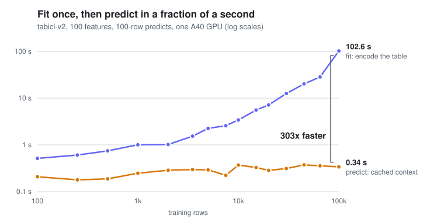

# Benchmarks

Every number here is from real GPUs, and every script that produced one
is in [`benchmarks/`](../benchmarks/) with its saved output under
`benchmarks/baselines/`.

## Fit once, predict fast

<picture>
  <source media="(prefers-color-scheme: dark)" srcset="assets/fit-vs-predict-dark.svg">
  
</picture>

TabICLv2 on one A40, 100-feature tables, 100-row predicts, measured
against the serving endpoint (`benchmarks/sweep_admission.py`,
2026-10-20, `benchmarks/baselines/sweep-a40x4-tabicl-v2.json`). Drawn by
`benchmarks/plot_readme_figure.py`.

## Multi-replica serving on an A100 (v0.7.0)

All numbers below are from a live GKE deployment of **two replicas
sharing one A100-40GB** (v0.7.0, 2026-08-29,
`benchmarks/baselines/v0.7.0-2replica.json`), except where noted:

- **Multi-replica routing is correct, not assumed**: 80 sticky predicts
  across 8 datasets on 2 replicas produced zero spurious 404s, every one
  pinned to the replica that fit its dataset; 428 concurrent predicts
  clean. The same probe run WITHOUT the affinity header 404s about half
  the time -- the gap the `x-session-id` contract closes.
- **Cache reuse works**: warm `predict()` at ~107ms server-side against a
  ~1,367ms `fit()` (~13x), with TabICL's kv-cache enabled (v0.7.0) so
  repeat predicts genuinely skip the training-set re-encode.
- **Throughput scales with concurrency now**: 7.6 -> 14.2 -> 22.1 -> 27.1
  ops/sec at c=1/2/4/8 (peak ~2.9x the v0.5.0 single-replica plateau of
  ~9.4), zero backpressure through c=16. Same-context coalescing verified
  live (48 concurrent requests -> 32 GPU calls).
- **Eviction under real pressure**: filling a replica to 95% of its
  fraction-scaled budget evicts oldest-first with clean 404s for evicted
  contexts and no memory leak across repeated fit/evict cycles.
- **Real bugs found by testing, not reasoning**: a ~14x cache-accounting
  overestimate (v0.3.0), malformed input surfacing as a raw 500 (v0.5.0),
  the multi-replica routing gap itself (v0.6.0), and an upstream Ray
  Serve quirk where `request_router_config` changes never reach live
  proxies (see ROADMAP.md). Full list in [CHANGELOG.md](../CHANGELOG.md).
- **Column count scales linearly, not quadratically** (TabICLv2's
  inducing-point column attention, confirmed empirically out to 700
  columns; `benchmarks/baselines/v0.5.0-feature-sweep.json`, pre-kv-cache).

## Accuracy on real datasets

Both served models were fit on public datasets (the Kaggle classics, from
OpenML and scikit-learn) and scored on a held-out 20% split, next to
scikit-learn's HistGradientBoosting on the same features
(`benchmarks/eval_real_datasets.py`, 2026-10-20, tabctx 0.13.0 on 4x A40,
`benchmarks/baselines/eval-real-gateway-a40x4.json`). Accuracy / ROC-AUC
for classification, R² for regression; training sets capped at 10,000 rows.

| Dataset | Train rows × features | Boosting | TabICLv2 | TabPFN-3.5 |
|---|---|---|---|---|
| Titanic | 1,047 × 7 | 0.801 / 0.867 | 0.836 / 0.891 | 0.844 / 0.885 |
| Adult income | 10,000 × 14 | 0.862 / 0.916 | 0.869 / 0.921 | 0.875 / 0.927 |
| Bank marketing | 10,000 × 16 | 0.896 / 0.916 | 0.908 / 0.940 | 0.908 / 0.944 |
| German credit | 800 × 20 | 0.770 / 0.825 | 0.785 / 0.842 | 0.790 / 0.853 |
| Breast cancer | 455 × 30 | 0.939 / 0.987 | 0.974 / 0.994 | 0.974 / 0.996 |
| Digits (10 classes) | 1,437 × 64 | 0.961 / 1.000 | 0.994 / 1.000 | 0.994 / 1.000 |
| California housing (R²) | 10,000 × 8 | 0.834 | 0.872 | 0.893 |
| Ames house prices (R²) | 1,168 × 79 | 0.857 | 0.824 | 0.917 |

Categorical columns were sent as integer codes and missing numbers as the
training median, because prod ran 0.13.0, which takes numbers only. From
0.14 a missing cell can be sent as `null`, and from 0.15 text columns as
they are (the server codes them). Regression needs `"task": "regression"`
on fit, or, from 0.14, labels that look continuous.
