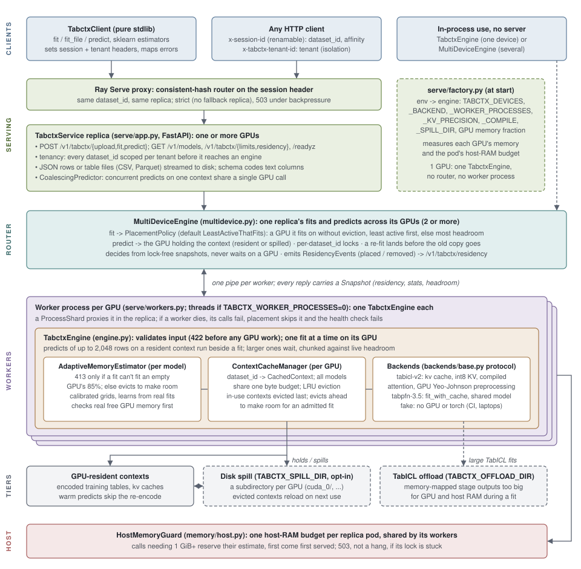

# How tabctx works

## Why it exists

Tabular foundation models like TabICL and TabPFN make predictions in an
unusual way: there is no per-dataset training loop. You hand the model a
labeled training table and the rows you want predictions for, and it
produces answers in a single forward pass -- the training table *is* the
prompt ("in-context learning"). That's what makes them exciting: one
pretrained model, any table, no training pipeline.

It also creates a serving problem. Encoding the training table is by far
the most expensive part of that forward pass, and it's identical every
time you predict against the same training set. Both TabICL and TabPFN
know this: each can cache its own encoded training table (both call it
their "KV cache") so repeat predictions skip the re-encode. But that cache lives inside one Python estimator object in
one process. The moment you want to *serve* these models -- many users,
many datasets, one GPU -- you need things a single object can't give
you:

- keep many datasets' encoded tables cached at once, each addressable
  by id, isolated per tenant;
- know how much GPU memory each one costs, evict the coldest when the
  budget fills, and refuse a request that would OOM the GPU *before*
  it runs;
- route repeat requests to wherever their cached table lives when the
  service scales past one replica.

**tabctx is that layer.** The unit it manages is a training table's
encoding: one context per table, cached, measured, evicted and routed
like any other shared resource. Hosted APIs such as Prior Labs' cache a
fitted table on their own servers; tabctx is the open, self-hosted
version, for several models at once, on GPUs you run.

It is plain Python on purpose. The heavy math runs in the models' own
GPU kernels, so the orchestration around them (the cache, admission,
routing) costs little next to a fit or a predict.

## Architecture

*Figure: a request enters through Ray Serve's consistent-hash proxy
(affinity on the session header) into a `TabctxService` replica, which
resolves the tenant, reads inline JSON rows or a table file (CSV or
Parquet, sent with the request or uploaded first), encodes text columns
with the context's schema, and coalesces
same-context predicts. With several GPUs, a `MultiDeviceEngine` places
each fit on one GPU and routes predicts to the GPU holding the context,
from lock-free snapshots; each GPU's engine runs in its own worker
process. A GPU's engine validates input, admits a fit on its estimated
memory need, keeps encoded contexts in a byte-budgeted LRU cache, and
dispatches to whichever backend fit the context. Evicted contexts
optionally spill to local disk and reload on their next use, and one
host-memory guard admits large fits against the pod's RAM across all
its workers. A single-GPU replica calls its one engine directly (editable
source: `docs/figures/architecture.svg`).*

The unit everything revolves around is a **context**: one training
table, encoded once by one model, addressed by `dataset_id` (scoped per
tenant) and reused by every later `predict()` against it. A context
carries its payload (the fitted estimator with its kv cache), the model
that fit it, its shape, its schema (column names, and the codes of its
text columns, so new rows are encoded the same way), plus a measured
byte cost. All models deployed on a device share one
cache and one memory budget, so admission control sees the whole
device's usage regardless of which model a request picks.

## How it works

- **`TabctxEngine`**: `fit(X, y)` returns a `dataset_id`, `predict(dataset_id, X_test)`
  reuses the cached context, and `fit_predict()` is there for one-shot callers who don't
  need caching.
- **`ContextCacheManager`**: a multi-tenant, LRU-evictable cache of encoded
  training contexts, sized against a real memory budget.
- **`AdaptiveMemoryEstimator`**: admission control that starts from a
  conservative static formula and gets progressively less conservative as
  the service accumulates real per-`fit()` GPU measurements, safely (only
  ever using a real measurement to bound a *smaller-or-equal* future
  request, never to extrapolate upward).
- **Chunked prediction**: large test sets are automatically split against
  the memory budget so one oversized request can't crash the whole
  replica, the failure mode this library exists partly to prevent (the
  naive one-shot wrapper it replaces did crash this way; see
  [CHANGELOG](../CHANGELOG.md)). Chunks are sized by a measured predict cost
  model (`memory/predict.py`): against a kv context a predict's memory
  follows its test rows and their width, not the training table, so a
  100-row predict against a 10,000 x 500 context is one call. A chunk that
  still OOMs is halved and retried.
- **TabICL's kv-cache, actually on**: tabicl ships with its fit-time
  context cache disabled, which makes every `predict()` re-encode the
  whole training set. tabctx enables it by default
  (`TABCTX_KV_CACHE=kv|repr|off`), with predictions verified identical
  to the uncached path -- and loads the pretrained backbone once per
  process instead of per fit.
- **int8 context cache** (`TABCTX_KV_PRECISION=int8`, the default):
  TabICL's ICL key/value cache, most of a context, is stored in int8:
  about half the memory per context, identical labels and metrics on the
  evaluation sets, probabilities within 0.009 (`native` for exact).
- **Compiled attention blocks** (`TABCTX_COMPILE=1`, the default):
  TabICL's attention blocks run through `torch.compile`, which fuses the
  memory-bound layer norms and residual adds around each attention
  kernel. Fits are 1.7-2.2x faster on the GPU with ~20% lower peak
  memory, and accuracy is unchanged. The compile happens mostly once per
  worker at startup (~130 s); a call shape the startup didn't cover (very
  large tables, for one) compiles on first use, ~10 s once per worker.
- **GPU preprocessing** (`TABCTX_FAST_PREPROCESSING=1`, the default):
  TabICL's per-column Yeo-Johnson fits, most of a fit's CPU time, run
  vectorized on the GPU (14x faster on a 40k x 100 table) with lambdas
  matching scikit-learn's to float32 precision.
- **Same-context coalescing** (`CoalescingPredictor`): concurrent
  requests against one cached context are packed into a single GPU call
  within a ~5ms window and split back per caller, amortizing per-call
  overhead without adding concurrent GPU calls (each GPU still runs at
  most one predict at a time, beside at most one fit).
- **Several GPUs per replica** (`MultiDeviceEngine`): one engine per GPU,
  each in its own worker process, behind the single-engine API; see
  [Several GPUs in one replica](serving.md#several-gpus-in-one-replica).
- **Host-memory admission** (`HostMemoryGuard`): large TabICL fits stage
  tens of GiB in host RAM, so calls of 1 GiB or more reserve their
  estimated host bytes against one budget shared by the pod's workers (first
  come, first served), so two huge fits queue instead of getting the pod
  OOM-killed with every tenant's context.

## Serving many applications from pre-computed contexts

A natural deployment shape for these models: an admin uploads a cohort
table for an application, the model encodes it once, the encoded context
(TabICL's kv cache) is saved, and end users of that application only ever
call `predict` against it -- one deployment, many applications, each a
loaded context. Here is exactly how far the current library gets you and
what is still missing.

**Works today:**

- *Publish an application* = `fit_file(<table file>, dataset_id=<app>)`
  under the admin's tenant; the context is encoded once and cached on
  the GPU. The training table's schema (column names, text categories)
  is recorded on the context, so test tables are encoded the same way
  and test files are matched to its columns by name.
- *Select an application* = `predict(<app>, ...)` with the same tenant
  header. Many applications coexist in one deployment under one memory
  budget; both models can be mixed (`model="tabicl-v2"` / `"tabpfn-3.5"`).
- *Save the kv cache to disk* = the spill tier (`TABCTX_SPILL_DIR`).
  Contexts evicted under memory pressure are serialized (TabICL's shared
  backbone excluded) and reload transparently on the next predict, and a
  restarted replica pointed at the same directory can reload its
  predecessor's spilled contexts -- no training data needed.

**Missing (see [ROADMAP.md](../ROADMAP.md), item 1):**

1. **Explicit, durable persistence.** Spilling happens only *on
   eviction*, to replica-local disk, best-effort and LRU-bounded. There
   is no "persist this context" call, no pinning (exempt from eviction),
   and no shared store (object storage / PVC) a fresh replica or a second
   deployment could load from. Contexts that were never evicted are lost
   on restart.
2. **Offline pre-computation.** Encoding only happens through the
   serving endpoint. Publishing an application should also work as a
   batch job that fits and writes the context to the shared store, with
   the deployment warm-loading a manifest of contexts at start.
3. **A catalog.** You must already know a `dataset_id`; there is no
   `GET /v1/tabctx/datasets` listing an application's contexts with
   their task, model, shape, schema and residency (GPU / spilled /
   persisted). The schema now travels with the context, so this is
   mostly an endpoint.
4. **Roles.** Tenancy is namespacing, not authorization: a tenant that
   can predict can also re-fit or evict. "Admin publishes, users predict"
   needs scoped credentials at the gateway (or read-only tenant tokens).
5. **Per-application endpoints.** `/v1/apps/<app>/predict` is a thin
   alias onto (tenant, dataset_id, model) and belongs in the gateway or
   a small application resource, not in the engine.
6. **Portable context format.** Serialized contexts are pickled
   estimators tied to the tabicl/torch versions and device they were
   fit on. A durable store needs a versioned format with a compatibility
   check and a fallback to re-fit from the stored table.
